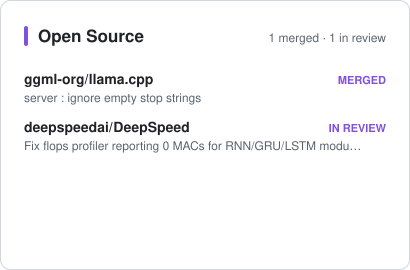
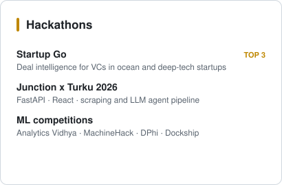
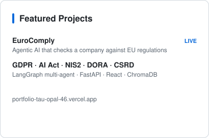
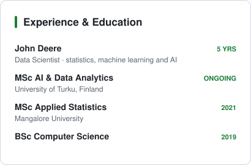
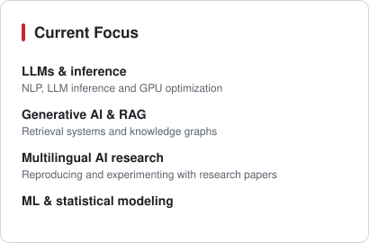
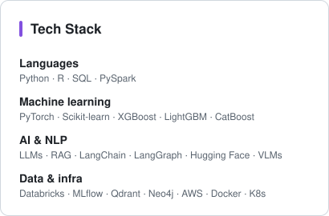

  

  <a href="https://portfolio-tau-opal-46.vercel.app/"><b>Portfolio</b></a> ·
  <a href="https://github.com/roshankumarg529?tab=repositories"><b>Repositories</b></a> ·
  <a href="https://github.com/search?q=author%3Aroshankumarg529+type%3Apr+is%3Amerged+-user%3Aroshankumarg529&type=pullrequests"><b>Merged PRs</b></a>

  
  
  
  
  
  

<b>Open source pull requests</b> (updated automatically)

<!-- OSS:START -->
- [ggml-org/llama.cpp](https://github.com/ggml-org/llama.cpp/pull/32093): server : ignore empty stop strings (merged)
- [deepspeedai/DeepSpeed](https://github.com/deepspeedai/DeepSpeed/pull/9090): Fix flops profiler reporting 0 MACs for RNN/GRU/LSTM modules and cells (in review)
<!-- OSS:END -->

<i>Building. Experimenting. Learning.</i>

